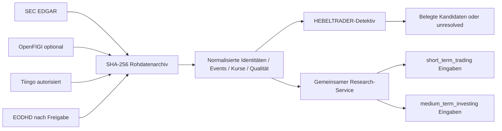

# V2.2 Anbieterentscheidung – Aktien- und Nachrichtenevidenz

Stand der Prüfung: 23. Oktober 2026. Preise und Nutzungsrechte können sich ändern und müssen vor
jeder Buchung erneut geprüft werden. Dieser PR aktiviert keinen kostenpflichtigen Dienst.

## Entscheidung

1. **SEC EDGAR** wird als erste reale Live-Quelle für ein US-Aktienuniversum und datierte
   regulatorische Unternehmensereignisse implementiert. Die Quelle ist öffentlich und kostenlos.
   Der Client setzt einen identifizierbaren User-Agent, bleibt deutlich unter der veröffentlichten
   Grenze von 10 Anfragen/Sekunde und archiviert Antworten unveränderlich.
2. **OpenFIGI** bleibt die optionale Kennungsquelle. Ohne Schlüssel gelten laut offizieller
   Dokumentation 25 Mapping-Anfragen pro Minute mit höchstens 10 Jobs je Anfrage; mit Schlüssel
   25 Anfragen pro sechs Sekunden und 100 Jobs. Treffer bleiben Kandidaten und werden nicht
   automatisch historisch verifiziert.
3. **Tiingo** bleibt für bereits autorisierte US-Kursarchive integriert. Tiingo nennt 500 Symbole
   pro Monat, 1.000 Anfragen pro Tag und lange EOD-Historie im kostenlosen Starter-Angebot. Der
   Anbieter beschreibt globale Aktienabdeckung im Wesentlichen als USA plus chinesische A-Aktien.
   Bezahlte Individual-/Commercial-Angebote ab etwa 30/50 USD liegen über dem Zusatzbudget.
4. **EODHD** bleibt optional für globale EOD-Daten. Der öffentlich genannte All-World-EOD-Tarif
   liegt bei 19,99 USD monatlich und damit knapp innerhalb der Grenze; Fundamentaldaten werden mit
   59,99 USD und das Gesamtpaket mit 99,99 USD genannt. Eine Buchung erfordert daher ausdrückliche
   Freigabe, und Nachrichten/Fundamentaldaten sind im Budget nicht abgedeckt.

## Vergleich

| Quelle | Umfang | Historie/Zeitbezug | Limits/Kosten | Nutzungs- und Qualitätsgrenze | Entscheidung |
|---|---|---|---|---|---|
| SEC EDGAR | US-Filer, Börsenticker, Filings, XBRL | Filings seit 1994/95; Acceptance-Zeitpunkt | kostenlos; max. 10 req/s, Client nutzt ≤ 1 req/s | regulatorische Filings, keine allgemeine Nachrichtenagentur; keine WKN/ISIN | implementiert |
| OpenFIGI | globale Instrumentkennungen und Listings | aktuelle Kandidaten; historische Gültigkeit nicht automatisch belegt | kostenloser Key optional; dokumentierte Limits | keine Nachrichten, Kurse oder Fundamentaldaten; Mehrfachlistings | bestehender Adapter |
| Tiingo | US-Aktienkurse, begrenzte weitere Märkte; optionale News/Fundamentals | lange EOD-Historie; Anbieter nennt 20 Jahre News | Starter kostenlos, bezahlt ab ca. 30 USD | Lizenz/Redistribution und News-Add-on vor Produktbetrieb prüfen | bestehender Adapter, keine neue Buchung |
| EODHD | 60–70+ Börsen, EOD, optional Fundamentals/News | Anbieter nennt 30+ Jahre EOD | 19,99 USD EOD; 59,99 USD Fundamentals | Tarif- und Redistributionsrechte vor Nutzung bestätigen | optional, nicht aktiviert |

## Quellen

- SEC, *Accessing EDGAR Data*: https://www.sec.gov/search-filings/edgar-search-assistance/accessing-edgar-data
- SEC, API-Dokumentation: https://www.sec.gov/edgar/sec-api-documentation
- OpenFIGI API-Dokumentation und Limits: https://www.openfigi.com/api/documentation
- Tiingo Anbieterübersicht 2026: https://www.tiingo.com/blog/best-stock-price-api
- Tiingo Dokumentation/Nutzungsrahmen: https://www.tiingo.com/documentation/general/overview
- EODHD Preisübersicht: https://eodhd.com/pricing
- EODHD Anbieter-Scorecard 2026: https://eodhd.com/financial-academy/financial-faq/the-2026-market-data-api-scorecard-comparing-6-leading-providers

## Blocker

Mit maximal 20 EUR monatlich steht keine geprüfte Quelle bereit, die zugleich ein globales
Aktienuniversum, historische Unternehmensnachrichten, Fundamentaldaten, WKN/ISIN, verlässliche
Zeitpunktverfügbarkeit und ausreichende serverseitige Darstellungsrechte liefert. SEC EDGAR schafft
eine reale US-regulatorische Basis. Europäische Nachrichten, Branchenabdeckung, WKN und
Optionsschein-Stammdaten bleiben unvollständig. Der Detektiv muss außerhalb belegter Abdeckung
`unresolved` liefern.

